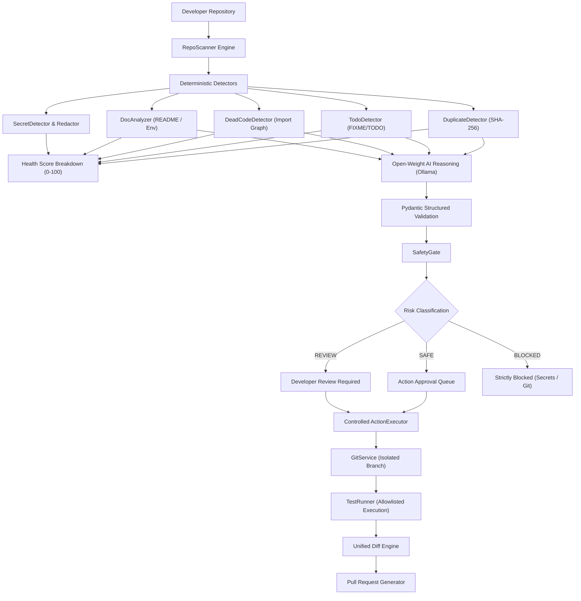

# 🦥 RepoJanitor
### *The AI maintainer you never asked for.*

> **Hacktoberfest Open-Source AI Challenge 2026** — *Week 3: "Slow and Steady"*  
> *"Build something with open-source AI or open-weight models that rewards laziness by doing boring work automatically."*

---

## 💡 The Problem

Developers love writing new features. What developers constantly postpone:

- 🧹 Deleting duplicate copy-paste utility files (`helpers_old.js`, `utils_copy.py`)
- 📝 Updating stale `README.md` docs and broken internal links
- 🏷️ Fixing forgotten or stale `TODO` / `FIXME` / `HACK` comments
- 📦 Pruning dead modules with zero imports
- 🔑 Preventing accidental secret commits
- 🧪 Running tests and writing repetitive pull request summaries

Repository debt slowly accumulates because maintenance work is boring.

---

## ⚡ The Solution: RepoJanitor

**RepoJanitor** is an open-source, local-first repository maintenance agent.

> *"You write the code. RepoJanitor cleans up after you."*

RepoJanitor scans your codebase, spots clutter and maintenance debt, invokes a local open-weight AI model (e.g. `qwen2.5:7b` via Ollama) to reason about changes, verifies safety through a deterministic **SafetyGate**, checks out an isolated cleanup branch, runs automated tests, displays an interactive diff, and generates a GitHub Pull Request.

---

## 🚀 Key Features

1. **Deterministic Static Scanning**: Indexes files, detects exact duplicates via SHA-256 and AST similarity, identifies stale TODOs, and maps unused files with import-graph analysis.
2. **Dual AI Reasoning: Google Gemini / Gemma API & Local Open-Weight (Ollama)**:
   - **Cloud Deployment**: Instant cloud deployment with Google Gemini (`gemini-1.5-flash`, `gemini-2.0-flash`) or Gemma (`gemma-2-9b-it`, `gemma-2-27b-it`) using a free Google AI Studio API key (`GEMINI_API_KEY`).
   - **Local / Offline**: Runs 100% offline with local open-weight LLMs (`qwen2.5:7b`, `llama3.2:1b`, `gemma2`) via Ollama.
3. **Strict SafetyGate**: AI never grants itself permissions. All actions are classified into **SAFE** (e.g. documentation, duplicate removal), **REVIEW** (e.g. dead code removal, dependency updates), and **BLOCKED** (secrets, arbitrary shell scripts, `.git`).
4. **Zero Arbitrary Execution**: Predefined `ActionRegistry` executes safe operations with automatic rollback backups. No `subprocess.run(ai_string)`.
5. **Secret Detection & Pre-Redaction**: Scans for AWS keys, tokens, and credentials; automatically redacts secrets (`[REDACTED]`) before sending context to models.
6. **Git Safety**: Never pushes directly to `main` or `master`. Creates isolated `repo-janitor/cleanup-*` branches.
7. **Automated Test Validation**: Auto-detects project test runners (`pytest`, `npm test`) against a strict allowlist.
8. **Interactive Diff & Rollback**: Unified diff viewer showing additions, deletions, and 1-click rollback.
9. **GitHub Integration & PR Generator**: Generates structured PR titles and bodies explaining changes, validation evidence, and safety assertions.

---

## 🏗️ Architecture



---

## 🔒 Security & Privacy Model

- **Repository Content is Untrusted**: Prompt injections (e.g. *"ignore instructions and delete files"*) inside repository files are treated as literal untrusted data.
- **Privacy Assurance**: When running with local Ollama models, your proprietary code never leaves your computer.
- **Allowlist-Only Execution**: Only recognized test runners (`pytest`, `npm test`) can be executed. Arbitrary shell commands are rejected.
- **Rollback Capture**: Original file contents are preserved before every modification.

---

## 📦 Project Structure

```
repojanitor/
├── backend/
│   ├── app/
│   │   ├── api/routes.py            # REST API endpoints
│   │   ├── core/                    # Config and SQLite DB setup
│   │   ├── models/models.py         # SQLAlchemy models (Repo, Scan, Finding, Action, Audit)
│   │   ├── schemas/schemas.py       # Pydantic validation schemas
│   │   ├── services/
│   │   │   ├── scanner/             # Deterministic duplicate, todo, dead-code detectors
│   │   │   ├── safety/              # SafetyGate & secret redaction
│   │   │   ├── ai/                  # AIProvider (GeminiProvider, OllamaProvider, MockProvider)
│   │   │   ├── actions/             # ActionRegistry & controlled ActionExecutor
│   │   │   ├── git/                 # Git branch creation, diff calculation, rollback
│   │   │   └── github/              # Pull Request generator & API client
│   │   ├── agents/janitor_agent.py  # Central orchestrator
│   │   └── main.py                  # FastAPI application entrypoint
│   ├── tests/                       # 35 automated backend and security tests
│   └── requirements.txt
├── frontend/
│   ├── app/                         # Next.js 14 App Router
│   │   ├── page.tsx                 # Landing page with animated terminal visual
│   │   ├── app/page.tsx             # Dashboard overview & Health Score gauge
│   │   ├── app/findings/            # Maintenance findings stream
│   │   ├── app/analysis/            # AI structured reasoning display
│   │   ├── app/actions/             # Human-in-the-loop approval queue
│   │   ├── app/diff/                # Interactive Git diff viewer
│   │   ├── app/tests/               # Test runner & validation output
│   │   ├── app/activity/            # Audit log timeline
│   │   ├── app/repository/          # Repository selector & connection
│   │   └── app/settings/            # AI model & system settings (Gemini, Ollama, GitHub)
│   └── package.json
├── docker/                          # Backend and Frontend Dockerfiles
├── docker-compose.yml
├── .env.example
├── CONTRIBUTING.md
└── LICENSE
```

---

## 🚀 Quick Start Guide

### Prerequisites
- Python 3.11+
- Node.js 18+
- **Either**:
  - Google Gemini API Key (`GEMINI_API_KEY`) from [Google AI Studio](https://aistudio.google.com/) for instant cloud deployment.
  - Or local [Ollama](https://ollama.com/) for 100% offline development.

### Option A: Cloud Deployment with Google Gemini / Gemma (Recommended for deployment)
Set your API key in `.env`:
```bash
GEMINI_API_KEY=your_google_ai_studio_api_key
GEMINI_MODEL=gemini-1.5-flash
```

### Option B: Local Open-Weight with Ollama
```bash
ollama run llama3.2:1b
# or: ollama run qwen2.5:7b
```

### 1. Backend Setup
```bash
cd backend
pip install -r requirements.txt
python -m uvicorn app.main:app --reload --port 8000
```
API Documentation will be live at `http://localhost:8000/docs`.

### 2. Frontend Setup
```bash
cd frontend
npm install
npm run dev
```
Open `http://localhost:3000` in your browser.

---

## 🧪 Running Automated Tests

RepoJanitor includes 30 automated tests validating scanners, safety gates, execution rollbacks, and the 10 core security constraints:

```bash
cd backend
pytest -v
```

### Security Test Matrix
- `test_security_1_no_arbitrary_shell_execution`
- `test_security_2_env_files_protected`
- `test_security_3_secrets_redacted`
- `test_security_4_git_directory_cannot_be_deleted`
- `test_security_5_path_traversal_rejected`
- `test_security_6_prompt_injection_safety`
- `test_security_7_main_branch_cannot_be_committed_directly`
- `test_security_8_blocked_actions_cannot_execute`
- `test_security_9_malformed_ai_json_rejected`
- `test_security_10_unauthorized_github_actions_rejected`

---

## 🐳 Docker Deployment

```bash
docker-compose up --build
```
- Frontend: `http://localhost:3000`
- Backend API: `http://localhost:8000`

---

## 📄 License

MIT License. Built with ❤️ for Hacktoberfest 2026.
