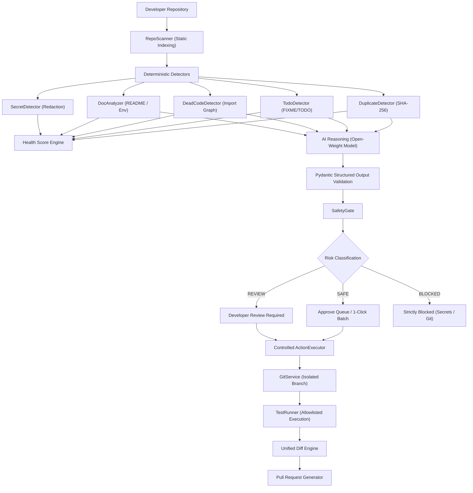

# RepoJanitor Architecture

RepoJanitor is designed as an agentic pair-programming system that relieves developers of tedious repository maintenance without compromising safety or developer control.

## System Workflow Diagram

## Security Model & Threat Mitigation

| Threat Vector | Mitigation Strategy |
| :--- | :--- |
| **Command Injection** | No `subprocess.run(ai_generated_command)` is ever allowed. All actions map to an explicit, typed `ActionRegistry`. |
| **Prompt Injection** | Code sent to LLMs is explicitly marked as `UNTRUSTED DATA`. The system policy prevents repository content from changing rules. |
| **Secret Leaks** | High-entropy secrets and credential files are redacted before being displayed or sent to models. |
| **Unsafe Git Pushes** | Commits to `main` or `master` are strictly rejected. All changes happen in isolated `repo-janitor/cleanup-*` branches. |
| **Path Traversal** | `SafetyGate.is_path_safe` resolves paths against the repository root and blocks traversal outside repo boundaries. |
